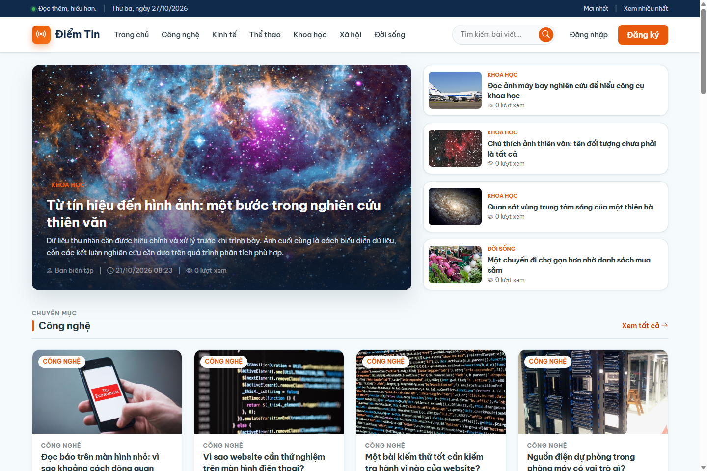
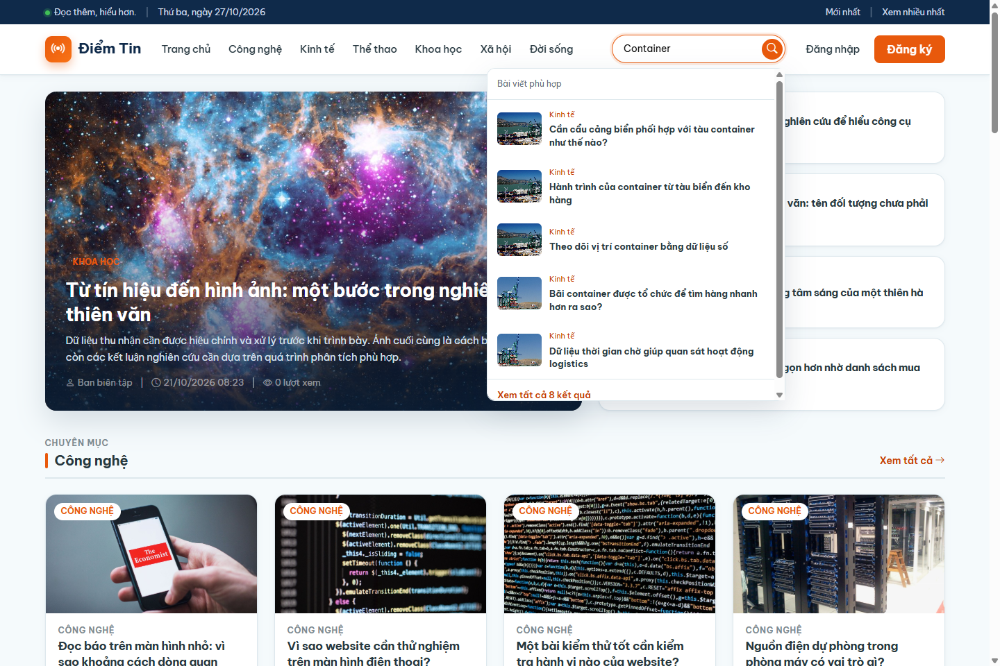
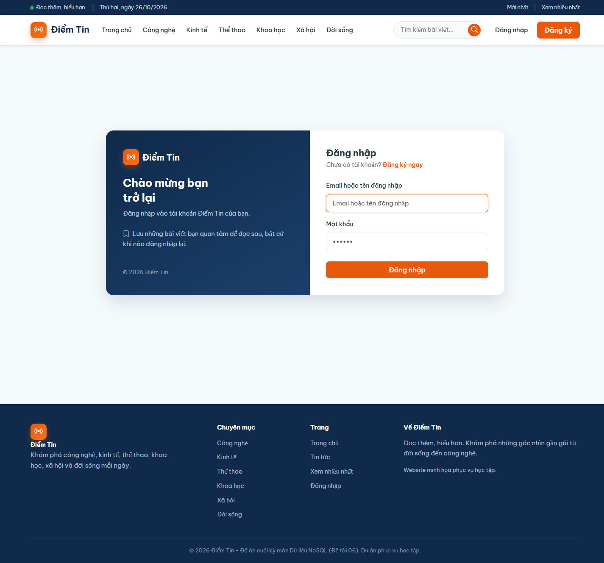
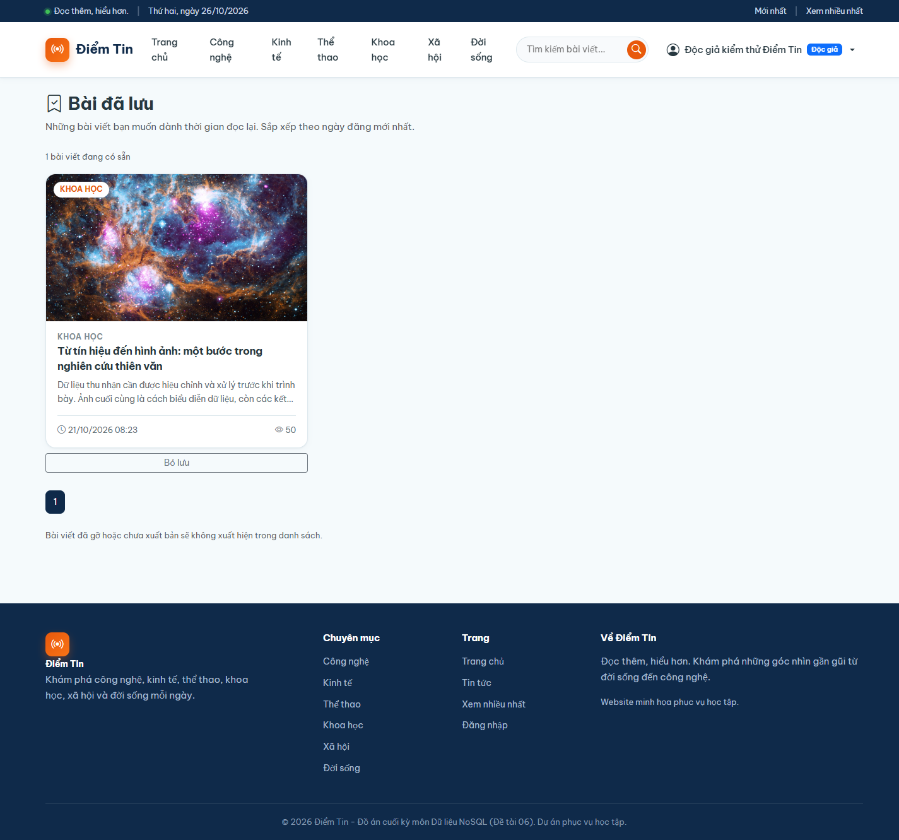

# Điểm Tin — Cache-Aside và quản lý phiên

Đồ án **Dữ liệu NoSQL, đề tài 06**, dùng **Flask + MongoDB + Redis**. MongoDB lưu nội dung và tài khoản; Redis lưu cache, khóa nạp cache, phiên, lượt xem và bài đọc sau. Giao diện tiếng Việt; ảnh, font, Bootstrap đi kèm source, không dùng CDN.

## Giao diện minh họa

**Trang chủ** — bài nổi bật và nội dung theo chuyên mục.



<details>
<summary>Xem thêm: gợi ý tìm kiếm, đăng nhập và bài đã lưu</summary>

**Gợi ý tìm kiếm** — nhập “Container” để xem các bài viết liên quan ngay dưới ô tìm kiếm.



**Đăng nhập** — giao diện tài khoản mang tên Điểm Tin.



**Bài đã lưu** — độc giả lưu bài để đọc sau; danh sách ID được quản lý bằng Redis Set.



</details>

Ảnh chụp từ môi trường demo; nội dung, ngày và số lượt xem có thể khác khi chạy trên máy bạn.

## 1. Chức năng và công nghệ

| Người dùng | Chức năng |
|---|---|
| Khách | Đọc/tìm gần đúng, gợi ý khi gõ, lọc chuyên mục, xem nhiều và bài liên quan |
| Độc giả (`reader`) | Các chức năng đọc tin, thông tin tài khoản, lưu/bỏ lưu bài và đăng xuất |
| Quản trị viên (`admin`) | Các chức năng trên, CRUD bài/bản nháp, xem người dùng, theo dõi cache/key/phiên |

**Chỉ có hai role `admin` và `reader`.** Khách là trạng thái chưa đăng nhập. Đăng ký luôn tạo reader. Màn quản trị người dùng hiện chỉ xem danh sách, không đổi role/xóa tài khoản.

| Thành phần | Sử dụng |
|---|---|
| Python | **3.13**, phiên bản nhóm đã kiểm thử, không bắt buộc đúng patch |
| Backend | Flask 3.1, Jinja2, Werkzeug |
| Database | MongoDB 8.x + PyMongo; Redis 8.x + redis-py |
| Frontend | Bootstrap 5.3.3, Bootstrap Icons 1.11.3, Be Vietnam Pro, HTML/CSS/JS |
| Kiểm thử/đo | pytest, requests, matplotlib |
| GUI tùy chọn | MongoDB Compass, Redis Insight |

Phiên bản thư viện Python được cố định trong [requirements.txt](requirements.txt). Cần Internet khi cài thư viện/tải Docker image lần đầu; sau đó giao diện dùng tài nguyên cục bộ. **Không cần Word, PowerPoint, thư mục `D:\Redis` hoặc công cụ dựng báo cáo để chạy web.**

## 2. Clone và cài đặt — Windows PowerShell

```powershell
git clone https://github.com/HoangThaNHty/Do_An_NOSQL.git
cd Do_An_NOSQL
py -3.13 -m venv .venv
.venv\Scripts\python -m pip install -r requirements.txt
if (-not (Test-Path .env)) { Copy-Item .env.example .env }
```

Không cần activate venv. Sửa `.env` theo máy: `SECRET_KEY` là chuỗi ngẫu nhiên riêng, MongoDB/Redis trỏ đúng dịch vụ của bạn. Không commit `.env`. Cấu hình mặc định cho demo cục bộ:

```dotenv
MONGO_URI=mongodb://127.0.0.1:27017
MONGO_DB_NAME=nosql_news
REDIS_HOST=127.0.0.1
REDIS_PORT=6379
REDIS_DB=0
REDIS_PASSWORD=
PORT=5000
FLASK_DEBUG=0
SIMULATED_DB_LATENCY_MS=0
```

### 2.1. Bật MongoDB và Redis

Nếu máy đã cài hai dịch vụ, bật chúng và chuyển sang bước 2.2. Không cần đúng bản Redis Windows trên máy trưởng nhóm; chỉ cần server tương thích và cấu hình kết nối đúng.

Nếu chưa có dịch vụ, có thể dùng **Docker Desktop (Linux containers) + Compose v2**:

```powershell
docker compose up -d --wait
docker compose ps
```

[compose.yaml](compose.yaml) chỉ chạy DB, Flask vẫn chạy trên host. Named volumes giữ dữ liệu; Redis bật AOF. Cổng DB chỉ bind `127.0.0.1`. Không bật Compose nếu dịch vụ cũ đang chiếm 27017/6379. Muốn đổi cổng: đặt `MONGO_PORT_HOST`/`REDIS_PORT_HOST` cho Compose và sửa tương ứng `MONGO_URI`/`REDIS_PORT` của app.

```powershell
docker compose stop   # dừng, giữ dữ liệu
docker compose start # chạy lại
```

Không dùng `docker compose down -v` để khởi động lại: `-v` xóa volume dữ liệu. Nguồn chính thức: [MongoDB image](https://hub.docker.com/_/mongo), [Redis image](https://hub.docker.com/_/redis), [Compose](https://docs.docker.com/compose/gettingstarted/).

### 2.2. Nạp bài mẫu và chạy app

```powershell
.venv\Scripts\python data/seed_articles.py
.venv\Scripts\python app.py
```

Mở **http://127.0.0.1:5000**. Seed nạp đến 100 bài, dùng ảnh sẵn trong Git và tạo hai tài khoản nếu chưa có. Không cần tải ảnh/font hay nhận bản dump của máy khác. **Không cần `--reset` khi cài mới**; tùy chọn đó xóa bài hiện có.

| Tài khoản demo cục bộ | Mật khẩu | Role |
|---|---|---|
| `admin` | `123456` | Quản trị viên |
| `reader` | `123456` | Độc giả |

Đây là tài khoản mẫu cho DB demo riêng, không dùng cho website triển khai công khai. Seed không tự đổi mật khẩu tài khoản đã tồn tại. Thông tin mẫu không xuất hiện trên trang đăng nhập.

### 2.3. Kiểm tra chạy thành công

Giữ cửa sổ Flask chạy và mở PowerShell khác:

```powershell
Invoke-RestMethod http://127.0.0.1:5000/api/health
```

Cần có `app: ok`, `mongo: ok`, `redis: ok`. Trên web: có bài và ảnh; admin mở quản trị; reader lưu bài và mở **Bài đã lưu** trong menu tài khoản.

### macOS/Linux

Dùng `python3.13 -m venv .venv`; tạo `.env` từ `.env.example` nếu chưa có. Thay `.venv\Scripts\python` trong các lệnh bằng `.venv/bin/python`. Có thể dùng cùng Compose hoặc dịch vụ DB đã cài.

## 3. Cấu trúc source và vị trí nghiệp vụ

```text
app.py                  App factory, kết nối DB, DI, middleware phiên
config.py               Đọc .env, cấu hình TTL/khóa
.env.example            Cấu hình mẫu
compose.yaml            Hai dịch vụ DB cục bộ (tùy chọn)
controllers/            Route HTML/JSON, quyền, gọi service
models/                 MongoDB, chỉ mục, chuyển DTO, tìm gần đúng
services/               Nghiệp vụ bài/cache/auth/session/saved
views/                  Jinja2: đọc tin, tài khoản, quản trị, partials
static/                 CSS/JS, ảnh, font, Bootstrap/icons cục bộ
data/                   Bộ bài mẫu, seed, benchmark, backup/restore
tests/                  pytest và script MCP Playwright
docs/                   Kiến trúc, kiểm thử, demo, đóng góp và kết quả
```

| Mảng | Đọc các file |
|---|---|
| CRUD, dữ liệu/index | `models/article.py`, `models/user.py`, `services/article_service.py` |
| Cache/khóa/Lua/invalidation | `services/cache_service.py` |
| Auth/session/cookie | `services/auth_service.py`, `services/session_service.py`, `controllers/auth_controller.py`, `app.py` |
| Quyền | `controllers/__init__.py` và decorator tại route |
| Đọc sau | `services/saved_service.py`, `controllers/saved_controller.py`, `static/js/saved.js` |
| Tìm/gợi ý | `models/search.py`, `controllers/article_controller.py`, `static/js/search.js` |
| Dữ liệu mẫu | `data/article_catalog.py`, `data/article_details.py`, `data/seed_articles.py` |

Repo giữ đủ tài nguyên runtime và test. Môi trường Python, `.env`, backup, log/ảnh trình duyệt, script cá nhân, Word/PDF/PPTX và file dựng báo cáo được giữ cục bộ. Lịch sử commit gốc vẫn được bảo toàn; ignore một file không xóa nó khỏi commit quá khứ.

## 4. Luồng và thiết kế dữ liệu

**Đọc bài:** Controller → ArticleService → Redis `HGETALL`. HIT giải mã bản sao. MISS thử `SET NX PX`, kiểm tra cache lần hai rồi mới đọc MongoDB. Lua đối chiếu token trước ghi cache/TTL/nhả khóa. Người chờ kiểm tra lại cache, tối đa khoảng 2 giây, sau đó `503` + `Retry-After: 1`. Lease 10 giây không tự gia hạn.

Chỉ `published` được công khai. GET trang HTML tăng lượt xem; API GET chi tiết không tăng. HIT nội dung không đồng nghĩa cả trang không đọc MongoDB: còn chuyên mục/bài liên quan.

**Ghi bài:** MongoDB là nguồn chính. Tạo mới làm mới cache danh sách. Sửa/xóa thêm thu hồi cache thường/hot và khóa của bài. Version danh sách chặn loader cũ publish sau invalidation. Chưa có giao dịch phân tán hay bảo đảm phục vụ liên tục khi DB lỗi.

**Phiên:** xác minh hash tại MongoDB → SID ngẫu nhiên → Session Hash Redis + TTL → cookie `HttpOnly`, `SameSite=Lax`. Request hợp lệ gia hạn cả TTL và cookie. Logout xóa phiên/cookie, không xóa bài đã lưu.

**Đọc sau:** Set riêng `user:saved:<uid>`, lấy uid từ session. `SADD` không trùng, `SREM` bỏ lưu, `SISMEMBER` hiện trạng thái nút, `SMEMBERS` lấy ID rồi MongoDB lọc published. Sắp theo ngày đăng, không theo ngày lưu. Set không TTL nhưng vẫn phụ thuộc persistence/eviction của Redis.

**Tìm kiếm:** Python chuẩn hóa dấu, so từ/tiền tố/lỗi gõ và nhóm chủ đề giới hạn; chưa phải AI, text index hay Redis Search. UI debounce và hủy request cũ. Liên quan cùng chuyên mục, loại trừ bài đang đọc. Xem nhiều xếp từ counter Redis trước phân trang, không phải số người xem duy nhất hay tổng vĩnh viễn.

| Key | Kiểu | TTL mặc định |
|---|---|---|
| `article:cache:<id>` | Hash | 300 giây |
| `article:list:v2:...` | String JSON | 60 giây |
| `session:<sid>` | Hash | 1800 giây, gia hạn khi hoạt động |
| `article:views:<id>` | String counter | 86400 giây, gia hạn khi tăng |
| `user:saved:<uid>` | Set | Không TTL |
| `lock:<cache-key>` | String token | PX 10000 ms |
| `stats:cache:*`, `meta:article-list-version` | String counter | Không TTL |

Chi tiết: [ARCHITECTURE.md](docs/ARCHITECTURE.md).

## 5. Các nhóm API

| Endpoint / phương thức | Quyền |
|---|---|
| `GET /api/articles`, `/api/articles/search`, `/api/articles/suggestions`, `/api/articles/<id>` | Công khai, chỉ published |
| `POST /api/articles`, `PUT/DELETE /api/articles/<id>` | admin |
| `POST /api/auth/register`, `/api/auth/login`, `/api/auth/logout`; `GET /api/auth/session` | Theo trạng thái phiên |
| `GET /api/saved`, `PUT/DELETE /api/saved/<id>` | Đăng nhập; dữ liệu của tài khoản hiện tại |
| `GET /api/cache/stats`, `/api/cache/keys`, `/api/cache/sessions` | admin |
| `POST /api/cache/reset`, `/api/cache/invalidate/<id>` | admin |
| `GET /api/health` | Kiểm tra kết nối demo |

API bảo vệ trả `401` khi chưa đăng nhập, `403` khi thiếu quyền. Bài không có/chưa công khai trả `404`; đầu vào sai trả `400` tùy route. HTML có thể redirect hoặc hiển thị thông báo form.

## 6. Kiểm thử

Từ thư mục gốc, cần MongoDB và Redis đang chạy:

```powershell
.venv\Scripts\python -m pytest tests -q
```

`tests/conftest.py` chọn **Redis DB13** trước khi config đọc `.env`, tránh DB0 của app. DB13 phải dành riêng kiểm thử; đổi bằng `TEST_REDIS_DB` (1–15). MongoDB test dùng `nosql_news_test` và tên ngẫu nhiên, fixture có xóa DB test: không dùng chúng lưu dữ liệu cần giữ.

```powershell
# Nhóm test không cần DB đang chạy
.venv\Scripts\python -m pytest tests/test_search.py tests/test_benchmark.py -q
```

Mốc trước đóng gói: 71/71 pytest ngày 27/10; Playwright đọc sau 19/19 ngày 26/10/2026. Kết quả checkout sạch: [RELEASE_CHECK.md](docs/RELEASE_CHECK.md). [TESTING.md](docs/TESTING.md) mô tả phạm vi và script Playwright (không phải lệnh Node/npm chạy độc lập).

## 7. Seed Redis, hiệu năng và backup

App tự tạo cache/session khi dùng; không cần `seed_redis.py` để chạy web. Khi cần thêm key cho demo:

```powershell
.venv\Scripts\python data/seed_redis.py
```

Lệnh này ghi key cache/counter mẫu, tạo session minh họa và thống kê giả lập; không dùng stats seed làm số liệu hiệu năng. Tại lúc seed có khoảng 30 key cache/session có TTL, cùng counter/stats; key tự hết hạn theo thời gian.

```powershell
# Giữ app chạy, SIMULATED_DB_LATENCY_MS=0 khi đo thật
.venv\Scripts\python data/benchmark.py --n 200 --warmup 10 --http http://127.0.0.1:5000
.venv\Scripts\python data/plot_benchmark.py
# Delay chỉ để quan sát khóa
.venv\Scripts\python data/demo_lock.py --workers 12 --delay-ms 1000
.venv\Scripts\python data/backup.py
```

Restore: đọc `data/restore.py --help`, chọn DB đích riêng trước khi chạy. `--drop` xóa dữ liệu hiện có, không phải bước cài đặt. Backup chứa dữ liệu/phiên không đưa vào Git.

Giữ JSON/CSV đo gốc `data/result_benchmark.*`, 26/10/2026: 200 mẫu/nguồn, 10 warm-up. HTTP TB MISS 12,889 ms, HIT 8,554 ms; không khẳng định HTTP HIT dưới 5ms. [PERFORMANCE_REPORT.md](docs/PERFORMANCE_REPORT.md) tách số đo thật và mô phỏng.

## 8. Xử lý lỗi và tài liệu

| Hiện tượng | Kiểm tra |
|---|---|
| Không tìm thấy `py -3.13` | Cài Python 3.13 hoặc gọi đúng đường dẫn Python đang có |
| `ModuleNotFoundError` | Cài requirements bằng Python trong `.venv` |
| Mongo timeout / Redis refused | Dịch vụ/Compose, host/port/credentials trong `.env` |
| Cổng Compose bị chiếm | Dùng dịch vụ đã có hoặc đổi cổng host và `.env` |
| Trang chủ chưa có bài | Seed với đúng DB app sử dụng, không cần reset |
| Đổi `.env` chưa có hiệu lực | Ctrl+C dừng Flask rồi chạy lại |
| Session TTL tăng trở lại | Request gia hạn, kể cả tab thống kê admin |
| Thiếu ảnh/font | Clone đủ `static/`, không chạy script tải ảnh/font của máy cũ |
| Pytest không kết nối | Cần cả hai DB; chạy từ thư mục gốc và dùng DB test riêng |

- [Kiến trúc](docs/ARCHITECTURE.md)
- [Kiểm thử](docs/TESTING.md) và [đọc sau](docs/SAVED_ARTICLES_QA.md)
- [Demo web, Compass và Redis Insight](docs/DEMO_GUIDE.md)
- [Chi tiết thao tác trình bày](docs/DEMO_WALKTHROUGH.md)
- [Làm việc nhóm và PR](docs/CONTRIBUTING.md)
- [Kiểm tra bản phát hành](docs/RELEASE_CHECK.md)
- [Nguồn ảnh](static/images/CREDITS.md), [thành phần bên thứ ba](docs/THIRD_PARTY.md)

Các thành viên tạo nhánh từ main mới; các việc test model, chẩn đoán môi trường và tài liệu API offline vẫn dành cho thành viên tự thực hiện. File Word/PDF/PPTX nộp môn học được giữ riêng. Giấy phép source theo `LICENSE`; ảnh/font/vendor có nguồn và giấy phép riêng.
